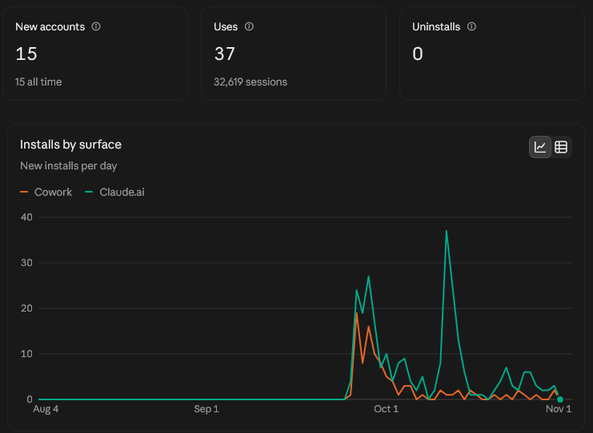
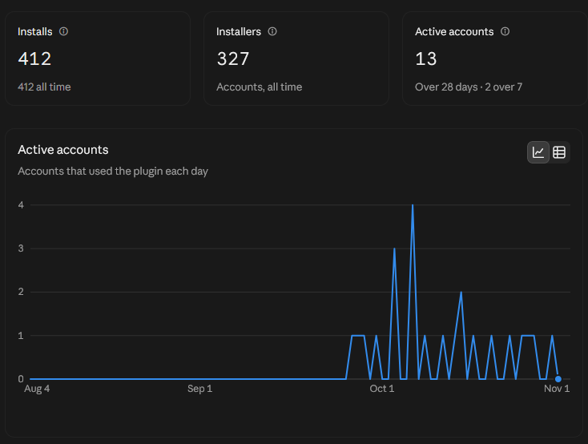
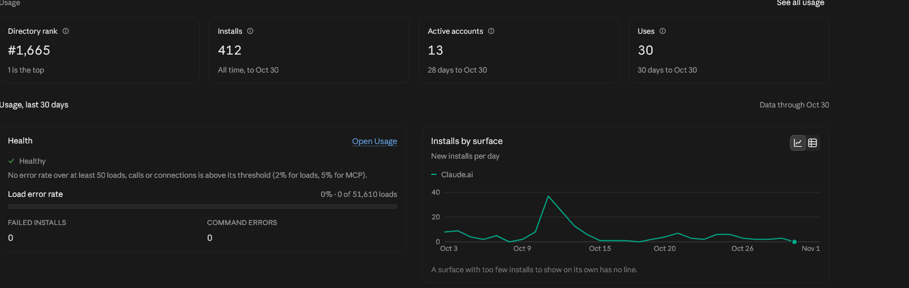

# claude-chat-namer

[](https://github.com/Jamaalx/claude-chat-namer/actions/workflows/ci.yml)
[](https://www.npmjs.com/package/claude-chat-namer)
[](LICENSE)

**Claude Code plugin** that names, searches, and helps you resume your conversations. No more UUID chaos.

Listed in Anthropic's plugin directory.

Claude Code stores conversations as UUID-named `.jsonl` files. This plugin names them, searches everything you typed across all your projects, gives you a `claude --resume` command that works from anywhere, and can pull an old conversation's context into the one you are in.

> Full features in Claude Code (terminal, desktop app, IDE). In Claude.ai and the other Claude apps it finds and recaps chats through Claude's past-chat search.

## In numbers

Small, but real: published in Anthropic's plugin directory on Oct 2, 2026, and used since.

<p align="center"></p>

<p align="center">
  
  
</p>

<details>
<summary>Full usage panel from the Anthropic plugin directory (Nov 1, 2026)</summary>

<br>



</details>

If it saves you some scrolling through UUIDs, a star helps others find it.

## Install

### As Claude Code Plugin (recommended)

The repo is its own plugin marketplace. Add it once, then install the plugin:

```bash
claude plugin marketplace add Jamaalx/claude-chat-namer
claude plugin install chat-namer@claude-chat-namer
```

Or from inside Claude Code:

```
/plugin marketplace add Jamaalx/claude-chat-namer
/plugin install chat-namer@claude-chat-namer
```

Restart Claude Code (or run `/reload-plugins`) and the `/chat-namer:*` commands and the auto-naming hook are active. Update later with `claude plugin update chat-namer@claude-chat-namer`.

### Try it without installing

```bash
git clone https://github.com/Jamaalx/claude-chat-namer.git
claude --plugin-dir ./claude-chat-namer
```

### As standalone CLI

```bash
npx claude-chat-namer
```

Or install globally:

```bash
npm install -g claude-chat-namer
claude-chat-namer list
```

## Features

### Real names, from wherever they come from

Every conversation gets the best name available, tagged with its source:

| Tag | Source |
|-----|--------|
| `[renamed]` | you used `/rename` inside Claude Code |
| `[named]` | you named it with chat-namer |
| `[ai]` | the title Claude Code generated |
| `[summary]` | the compaction summary |
| `[auto]` | the first thing you typed (slash commands are skipped) |

A `Stop` hook also gives each new conversation a first-message name after its first exchange, as a fallback. No configuration needed.

### Just ask

No commands to remember. Ask Claude the way you would ask a colleague, in any language:

```
> where did we talk about the stripe webhook?

  "Stripe billing", Oct 28, in /home/me/shop. To reopen it in a new terminal:
    cd /home/me/shop && claude --resume eeee5555-5555-4555-8555-555555555555
  Want me to pull it in here instead?

> yes, continue where we left off

  That chat stopped after adding signature verification; the open question
  was whether to retry failed events. ...
```

Three skills do the work and Claude picks them on its own:

| Skill | When it runs | Also as |
|-------|--------------|---------|
| `find` | "where did we talk about...", "that chat about...", "my recent chats" | `/chat-namer:find <words>` |
| `recap` | "continue what we did on...", "where did we leave..." | `/chat-namer:recap <words>` |
| `rename` | "name this chat", "give my chats proper names" | `/chat-namer:rename` |
| `sync-setup` | "sync my chats between my laptop and my server" | `/chat-namer:sync-setup` |
| `move` | "send this chat to my laptop", "bring the chat from the server" | `/chat-namer:move` |
| `inbox` | "look at the screenshot I just sent" | `/chat-namer:inbox` |

Search covers everything you typed in every project (all words must match, any order; title hits first, content hits with a snippet). The resume command includes the `cd`, because `claude --resume` only finds a conversation from the directory it was started in. Subagent traffic and tool output are left out.

**In Claude.ai and the other Claude apps** the same skills use Claude's own past-chat search when your plan and settings allow it (Settings > Capabilities): they find the chat and give you its link, pull its context into the current chat, and suggest clear names for you to set.

### Across machines

Same account on a laptop, a server and a desktop? Each machine keeps its own conversations. chat-namer can bring them together through a folder you keep in sync between them, with whatever you already use:

- **Syncthing over Tailscale** (recommended if you have Tailscale): direct and private, no cloud in between
- **a cloud folder** you already have: Dropbox, OneDrive, Google Drive, iCloud
- **Syncthing** on its own, or **a private git repo**

Ask Claude to *"set up sync between my machines"* on each machine; it installs and configures what is needed, with your approval at each step. Then, from any machine:

```
> where did we talk about the nginx cache?
    [server] "Nginx cache tuning", Oct 30, in /srv/api

> continue that here
    (recap of the server conversation, in this session)

> send this chat to my laptop            (on the server)
> bring the chat from the server here    (on the laptop)
    cd C:\code\api; claude --resume 1a2b3c4d-...

> look at the screenshot I just sent
```

- **Search and recap** work across machines right away. What a machine shares is a small index (titles, what you typed, the last exchanges), with secrets such as API keys, tokens and passwords redacted before they leave the machine. Projects you exclude are never shared.
- **Moving a whole conversation** copies its full transcript, only when you ask, and rewrites its working directory for the other machine (`sync map` remembers where each project lives there). Experimental: the transcript format is Claude Code's own and undocumented.
- **Files and screenshots**: drop them in the shared `inbox` folder, or with Tailscale use "Send with Tailscale" on the file. Ask Claude to look at the latest one. No `scp`, no paths.

### CLI Usage

```bash
claude-chat-namer                          # Interactive mode (browse + rename)
claude-chat-namer list [--all]             # List conversations
claude-chat-namer search stripe --all      # Search titles and content
claude-chat-namer resume stripe --all      # Jump back in, in the right directory
claude-chat-namer recap stripe --all       # Print the last messages
claude-chat-namer name c348 "Wolt Automation"  # Name by UUID prefix
claude-chat-namer unname c348              # Remove a name
claude-chat-namer auto                     # Auto-name all unnamed
claude-chat-namer sync init --dir ~/Sync/chat-namer   # Share through a synced folder
claude-chat-namer sync                     # Machines, sent conversations, settings
claude-chat-namer send stripe --all        # Put a whole conversation in the folder
claude-chat-namer receive stripe           # Install it here, ready for claude --resume
claude-chat-namer inbox --latest           # Newest file in the shared inbox
claude-chat-namer help                     # All commands and options
```

Options: `--all`, `--project <name>`, `--limit <n>`, `--json` (machine-readable, for scripts and agents), `--print` (resume: only print), `--turns <n>` (recap).

### Fast on big histories

Transcripts are streamed, never loaded whole, and the metadata is cached. Transcripts are append-only, so a grown file is read only from where the last run stopped. On 8 GB of transcripts (577 conversations): about 4 s the first time, about 0.3 s after that.

## How it Works

1. Scans `~/.claude/projects/` (or `$CLAUDE_CONFIG_DIR/projects/`) for conversation `.jsonl` files
2. Reads titles, the directory, and what you typed from each transcript
3. Stores your names in a `chat-names.json` file (per project directory) and a speed cache in `~/.claude/chat-namer/`
4. **Never modifies existing conversation files** and makes no network requests of its own; across machines it only reads and writes the folder you chose. See [PRIVACY.md](PRIVACY.md)

## Plugin Structure

```
claude-chat-namer/
├── .claude-plugin/
│   ├── plugin.json           # Plugin manifest
│   └── marketplace.json      # Marketplace manifest (lets you `claude plugin install` this repo)
├── assets/icon.svg           # Directory icon
├── skills/
│   ├── find/SKILL.md         # find / list / resume earlier conversations
│   ├── recap/SKILL.md        # continue an earlier conversation here
│   ├── rename/SKILL.md       # name conversations
│   ├── sync-setup/SKILL.md   # connect your machines
│   ├── move/SKILL.md         # move a conversation to another machine
│   └── inbox/SKILL.md        # files sent from another device
├── hooks/
│   └── hooks.json            # Stop hook for auto-naming
├── scripts/
│   ├── index.js              # Core API
│   ├── cli.js                # CLI interface
│   ├── sync.js               # Machines: shared index, send/receive, inbox
│   └── hook-auto-name.js     # Hook script
├── test/
│   └── smoke.sh              # End-to-end test against a throwaway HOME
├── package.json
└── README.md
```

## Development

```bash
bash test/smoke.sh          # runs the CLI + hook against fake transcripts
claude plugin validate .    # checks plugin.json / marketplace.json
```

CI runs the smoke test on Node 18, 20 and 22. See [CHANGELOG.md](CHANGELOG.md) for release notes.

## Zero Dependencies

Uses only Node.js built-ins (`fs`, `path`, `os`, `readline`). No `npm install` needed.

## License

MIT
